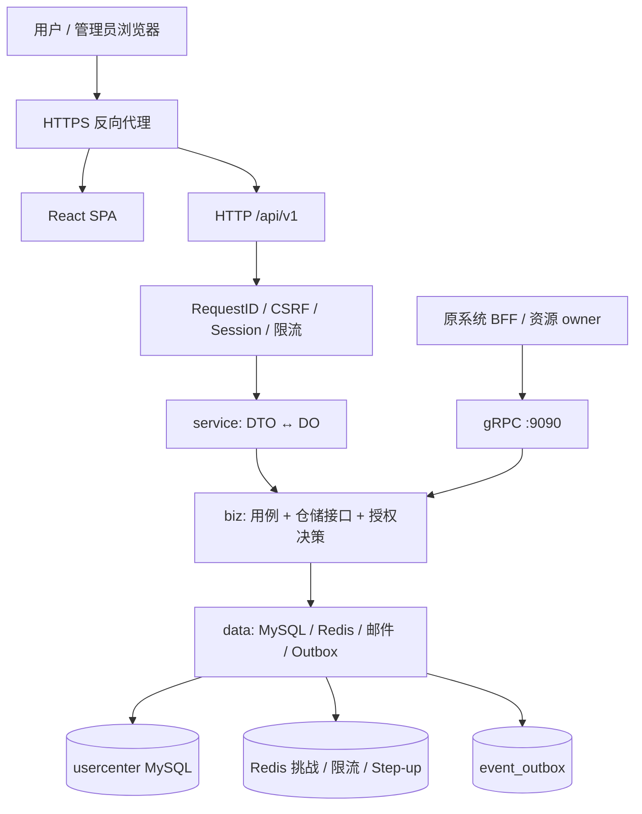

# User Center（统一用户中心）

从 [`micro-one-api`](https://github.com/mengbin92/micro-one-api) 抽离出来的独立用户中心。它拥有账号、凭据、邮箱验证、MFA、会话和平台 IAM 权限治理，拥有自己的 MySQL 数据库、Redis 命名空间、邮件适配器和前端 SPA，不依赖 Relay / Channel / Billing / Log / Config / Monitor / Notify 即可完成注册、登录、用户管理、密码恢复、MFA、会话撤销、角色授权与审计。

> **状态：v0.2.1 — V1 功能完成。** 设计依据：`用户中心独立项目设计文档.md`（2026-11-02）。剩余差异全部属于 V2 或需要真实第三方环境验收，见[实现范围](#实现范围与已知差异)。

## 目录

- [快速开始](#快速开始)
- [架构](#架构)
- [仓库结构](#仓库结构)
- [认证与安全模型](#认证与安全模型)
- [权限模型](#权限模型)
- [API 概览](#api-概览)
- [实现范围与已知差异](#实现范围与已知差异)
- [测试](#测试)
- [部署](#部署)
- [文档](#文档)

## 快速开始

### 本地 SQLite（无需 MySQL/Redis）

```bash
cd user-center

# 1. 建表 + 写入权限目录（SQLite 使用 AutoMigrate + SeedCatalog）
go run ./cmd/migrate -config configs/config.dev.yaml

# 2. 创建最高治理账号（离线命令，不接受 HTTP 万能口令）
go run ./cmd/admin-rescue -config configs/config.dev.yaml \
  -action bootstrap -username root \
  -password 'ChangeMe-12345' -email root@example.com

# 3. 启动 HTTP :8080 / gRPC :9090
go run ./cmd/user-center -config configs/config.dev.yaml
# 管理员默认被要求绑定 MFA：登录后先到 /account/security 完成 TOTP，
# 否则 /admin/* 返回 403 MFA_ENROLLMENT_REQUIRED。

# 4. 前端（另一个终端）
cd web && npm install && npm run dev   # http://localhost:5173
```

首次请求 `GET /api/v1/auth/context` 会下发 CSRF Cookie。浏览器端从 `uc_csrf` Cookie 读取令牌并在所有写请求中发送 `X-CSRF-Token`；会话只存在于 HttpOnly 的 `uc_session` Cookie 中。

### MySQL（生产形态）

```bash
cp configs/config.yaml configs/config.local.yaml   # 修改 DSN，勿提交真实密钥
export SESSION_SECRET="$(openssl rand -base64 48)"
export CSRF_SECRET="$(openssl rand -base64 48)"
export MFA_ENCRYPTION_KEY="$(openssl rand -base64 48)"
go run ./cmd/migrate -config configs/config.local.yaml
go run ./cmd/admin-rescue -config configs/config.local.yaml \
  -action bootstrap -username root -password '...' -email root@example.com
go run ./cmd/user-center -config configs/config.local.yaml
```

生产环境可用环境变量覆盖配置：`DB_DSN`、`REDIS_ADDR`、`SESSION_SECRET`、`CSRF_SECRET`、`MFA_ENCRYPTION_KEY`、`COOKIE_SECURE`、`COOKIE_DOMAIN`、`PUBLIC_BASE_URL` 等，详见 `internal/config/config.go`。内部 gRPC 使用数据库管理的接入客户端凭据。

## 架构



- **一个模块化的 Kratos 进程**：HTTP 与 gRPC 调用同一用例层，gRPC 不绕过任何校验。
- **分层契约**：`service` 只做 DTO ↔ DO；`biz` 拥有 DO、用例、仓储接口与决策；`data` 实现仓储与 PO。`cmd` 负责 Wire 装配。
- **独立数据权**：`users` 只保留身份字段；密码、MFA、外部身份、会话、IAM、审计各自成表。余额、路由组、API Key 等业务属性不进入用户中心。

## 仓库结构

```text
api/usercenter/v1/        auth / me / admin / iam / audit / settings / integration / integration_admin proto
cmd/user-center/          主服务（HTTP + gRPC + SPA）
cmd/migrate/              MySQL 版本化迁移 + 权限目录种子
cmd/admin-rescue/         离线 root 初始化 / 凭据恢复
cmd/import-legacy/        离线用户快照导入（dry-run / apply）
internal/conf/            配置 proto
internal/config/          配置加载 + 环境变量覆盖
internal/server/          HTTP/gRPC 装配、中间件、CSV 下载、SPA
internal/service/         DTO ↔ DO
internal/biz/             用例、端口、授权决策、审计、Outbox
internal/data/            GORM PO/仓储、Redis、邮件、种子
internal/wiring/          Wire ProviderSet 与 CLI 组装
domain/authorization/     纯授权类型、Scope 求交、决策、继承图
platform/httpx/           传输元数据契约
pkg/jsonx/                统一 JSON（sonic ConfigStd 语义）
pkg/totp/                 RFC 6238 TOTP
pkg/aesgcm/               AES-GCM
migrations/mysql/         版本化 DDL（001 起）
configs/                  无真实密钥的配置样例
deployments/docker-compose/
web/                      React 19 + TypeScript + Vite + Tailwind SPA
docs/                     架构 / API / 数据模型 / 迁移 / 运维 / 安全
scripts/                  开发与检查脚本
```

`pkg/jsonx`、`pkg/totp`、`pkg/aesgcm` 从 `micro-one-api` 按 MIT 许可证复制并独立维护；用户中心核心代码**不 import 原仓库**。

## 认证与安全模型

| 项 | 实现 |
|---|---|
| 浏览器会话 | 32 字节随机不透明令牌；DB 只存 SHA-256；HttpOnly + SameSite=Lax Cookie；服务端权威校验状态、身份版本、过期与空闲超时 |
| CSRF | 双提交 Cookie：非 HttpOnly 的 `uc_csrf` + 写请求 `X-CSRF-Token`；中间件对全部 `/api/v1` 非安全方法强制校验 |
| 密码 | bcrypt；最小字符数可配置（默认 10），最多 72 字节；修改密码后提升 `identity_version` 并撤销其他会话 |
| MFA | TOTP（RFC 6238）+ 8 个一次性恢复码；秘钥 AES-GCM 加密；`last_step` 防重放；5 次失败锁定 5 分钟 |
| Step-up | 高风险操作要求近期主认证 + 第二因素验证，证明绑定当前 session 与身份版本、5 分钟过期 |
| 邮箱 | 注册/换绑使用一次性验证码；验证码 HMAC 后存 Redis（无 Redis 时内存），单次消费 + 数据库完成记录幂等 |
| 审计 | 所有敏感写入在业务事务内写 `iam_audit_events`；登录与安全事件写 `security_events`；CSV 导出重新校验权限与范围 |
| 授权 | 权限目录 + 角色继承 + 分配边界 + 有效期 + 显式 deny + 职责分离约束；决策由服务端根据 DB 事实实时计算，客户端只消费投影 |

## 权限模型

- **Scope**：`all`、`self`、`user_ids`。授权关系 = 角色 Grant Scope ∩ 分配 Boundary；显式 deny 优先。
- **会话角色**：登录时默认激活全部有效分配；用户可在 `/me/session-roles` 切换到已分配角色的子集，切换时重新执行互斥约束。
- **数据范围**：管理员列表/详情/导出/会话接口同时执行操作权限与目标用户范围检查；受限管理员不会因分页或导出看到范围外用户。
- **职责分离**：`mutual_exclusion`（互斥角色）与 `max_roles`（角色数量）在分配和会话激活时分别校验。
- **内置角色**：`root`（受保护，拥有全部权限）、`admin`（账号与权限治理）、`member`（默认注册角色，仅本人范围）。

## API 概览

统一前缀 `/api/v1`，JSON 使用 `snake_case`，ID / revision 以十进制字符串输出。

| 接口族 | 路径 |
|---|---|
| 公开认证 | `/auth/context`、`/auth/registration-challenges`、`/auth/register`、`/auth/login`、`/auth/mfa/complete`、`/auth/logout`、`/auth/password-reset-challenges`、`/auth/password-reset` |
| 第三方登录 | `GET /auth/providers/{provider}/start`、`GET /auth/providers/{provider}/callback`（GitHub / Google；绑定使用 `?mode=bind`） |
| 本人 | `/me`、`/me/password:change`、`/me/email-challenges`、`/me/email:confirm`、`/me/security`、`/me/mfa:*`、`/me/sessions`、`/me/session-roles`、`/me/authorization`、`/me/security-events` |
| 用户管理 | `/admin/overview`、`/admin/users`、`/admin/users/{id}`、`{id}:set-status`、`{id}:archive`、`{id}/password-reset-requests`、`{id}/mfa:reset`、`{id}/email-changes*`、`{id}/sessions*`、`{id}/effective-permissions`、`/admin/users:export`、`/admin/exports/{id}`、`/admin/exports/{id}/download` |
| IAM | `/admin/iam/resources`、`permissions*`、`roles*`、`assignments*`（含列表）、`delegations*`、`constraints*`、`menus*`、`authorization:explain`、`authorization:simulate` |
| 接入服务 | `/admin/integration-clients*`、`/admin/event-deliveries*` |
| 审计 / 配置 | `/admin/audits*`、`/admin/settings/auth`、`/admin/settings/email` |
| 内部 gRPC | `ValidateSession`、`ValidateSubject`、`GetUser`、`BatchGetUsers`、`GetSessionAuthorization`、`GetResourceAuthorization`、`RevokeSession` |

完整契约见 [`openapi.yaml`](openapi.yaml) 与 `api/usercenter/v1/*.proto`。错误使用 HTTP 状态 + 稳定 `reason`（`REVISION_CONFLICT`、`STEP_UP_REQUIRED`、`PERMISSION_DENIED` 等），详见 [docs/api.md](docs/api.md)。

## 实现范围与已知差异

**已实现（V1）**：用户生命周期（创建/资料/启停/归档）、密码与邮箱变更、管理员邮箱变更、强制首次改密、TOTP + 恢复码、管理员强制 MFA、Step-up、会话治理、角色/会话角色、权限目录、角色继承、授权分配（含列表与批量，事务内整批拒绝）、委派、职责分离、菜单投影、授权解释/模拟、审计与导出、认证配置、GitHub/Google 登录与绑定、接入客户端管理、gRPC 客户端鉴权、Outbox Webhook 投递、`cmd/import-legacy` 离线导入。

**仍延后（V2 或需要外部环境）**：

- 组织/多租户、WebAuthn/Passkey、SCIM、标准 OIDC Provider（设计文档中均属 V2）；
- OAuth 真实提供方沙箱验收、生产 SMTP 送达验收：代码与 mock 测试已就绪，需配置真实凭据后执行；
- 委派目前约束“分配/撤销角色”的目标角色、用户范围与动作；角色 Grant/继承的变更仍要求直接权限，不允许通过委派修改策略本身；
- 原 `micro-one-api` 的 BFF 兼容层与适配器不在本仓库内，接入契约见 `docs/migration.md`；
- OpenAPI 未描述 Cookie/CSRF 安全方案与原始 OAuth/CSV 下载路由；这些在 `docs/api.md` 中约定；

这些差异不会把权限退化回 `role >= 10`：未实现的模块不暴露菜单/接口，而不是用空实现伪装完成。

## 测试

```bash
go test ./...           # 领域、仓储（SQLite）、HTTP 集成、MFA 全流程
cd web && npm test      # 前端组件测试
cd web && npm run build # tsc + vite 构建
```

关键覆盖：
- `domain/authorization`：Scope 求交/包含、deny、过期、继承环检测。
- `internal/data`：唯一约束、revision CAS、会话哈希/撤销、目录种子幂等、legacy 导入、GitHub/Google 适配器（本地 fake provider）、SMTP（本地 fake server）。
- `internal/server`：未登录 401、缺失 CSRF 403、登录、受限管理员越权 403、并发更新 409、导出下载、MFA 完整登录、注册/重置/改密、管理员邮箱变更、OAuth 绑定/登录/OAuth+MFA、委派、接入客户端与 Outbox 投递、MFA 强制与首次改密拦截。
- `docker build` / `docker buildx --platform linux/amd64`：镜像内迁移、健康检查与 SPA 均已验证。

## 部署

```bash
cd deployments/docker-compose
cp .env.example .env   # 设置 MYSQL_PASSWORD / SESSION_SECRET / CSRF_SECRET / MFA_ENCRYPTION_KEY
docker compose up -d --build
```

镜像同时包含 `user-center`、`migrate`、`admin-rescue` 与已构建的 SPA。`migrate` 以一次性任务运行，成功后主服务才启动。HTTPS、安全响应头与 Cookie `Secure` 由反向代理和 `COOKIE_SECURE=true` 共同保证。详见 [docs/operations.md](docs/operations.md)。

## 文档

- [架构与分层](docs/architecture.md)
- [API 契约与错误码](docs/api.md)
- [数据模型](docs/data-model.md)
- [从 micro-one-api 迁移](docs/migration.md)
- [运维手册](docs/operations.md)
- [安全设计](docs/security.md)
- [前端说明](docs/frontend.md)
- [代码审查与修复记录（2026-11-03）](docs/code-review-2026-11-03.md)

## License

MIT，见 [LICENSE](LICENSE)。`pkg/jsonx`、`pkg/totp`、`pkg/aesgcm` 来自 `micro-one-api`（Copyright (c) 2026 孟斯特），按同一许可证维护。
