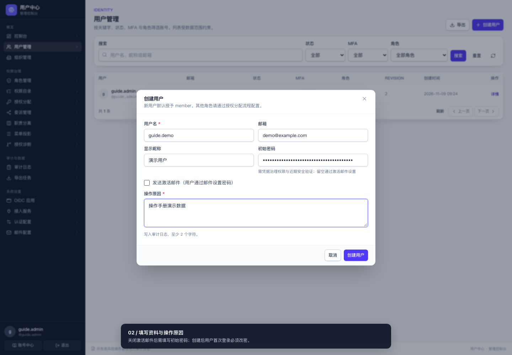
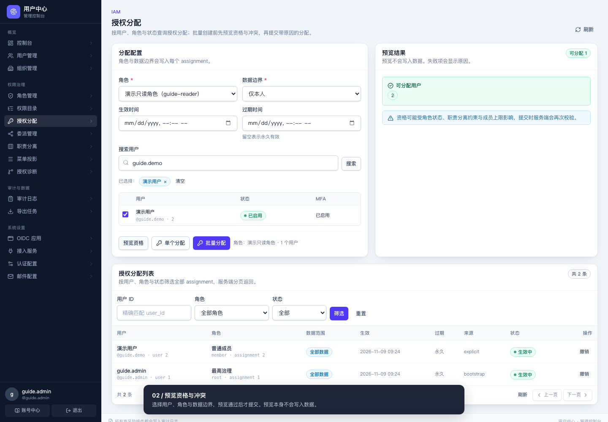
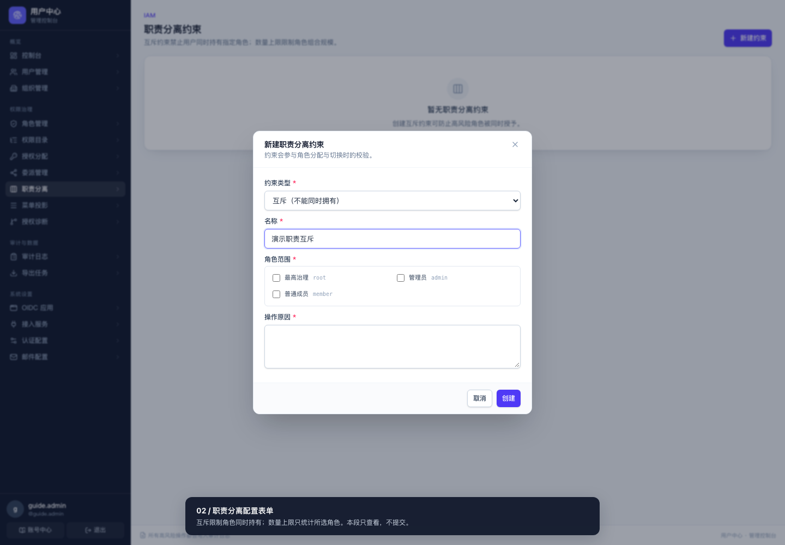
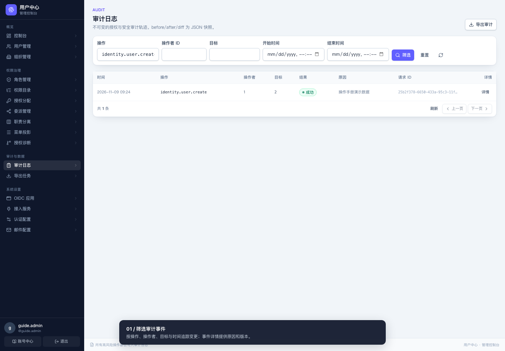
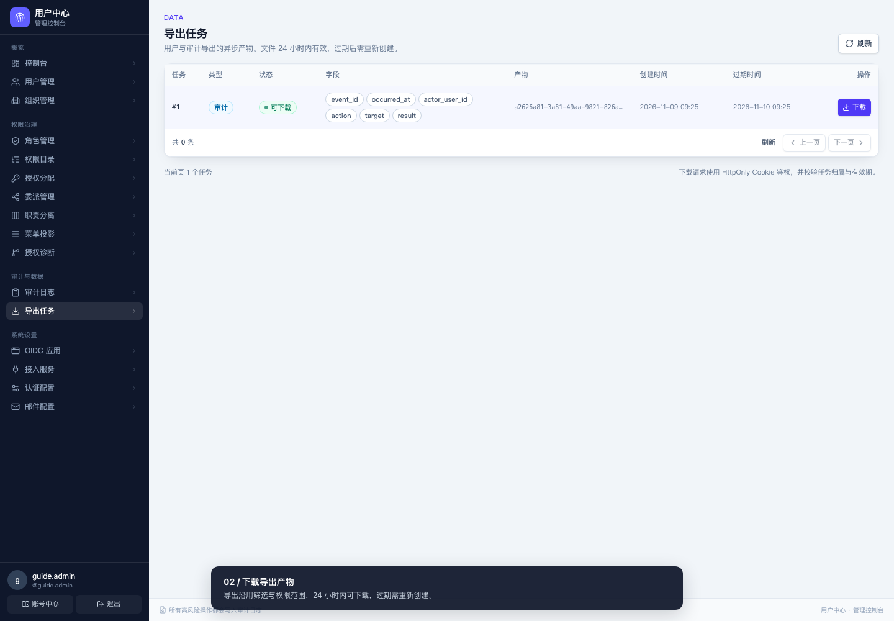
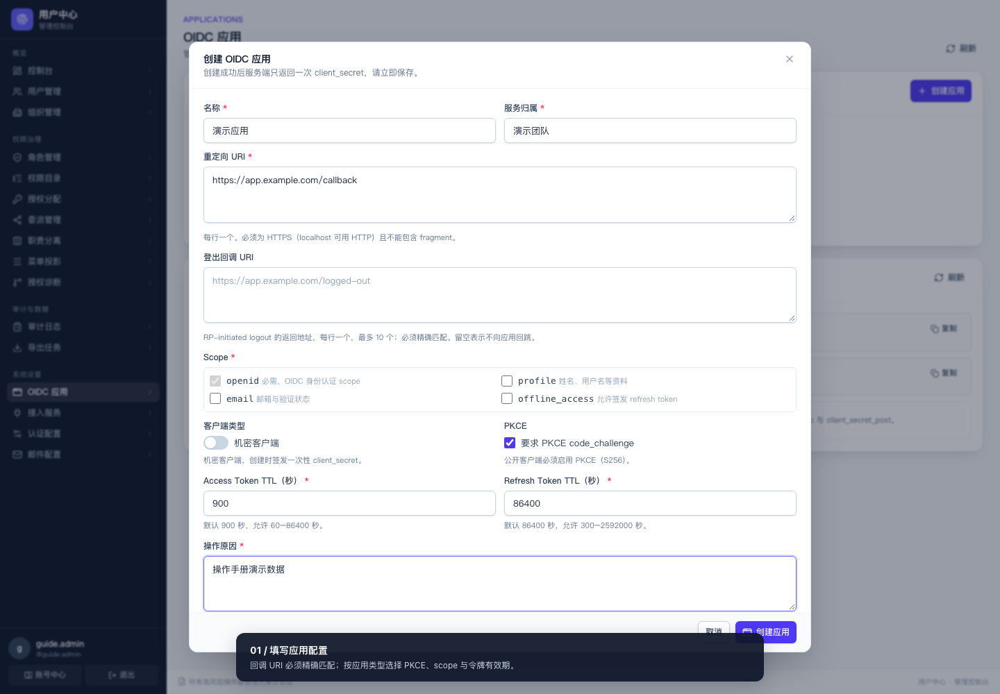
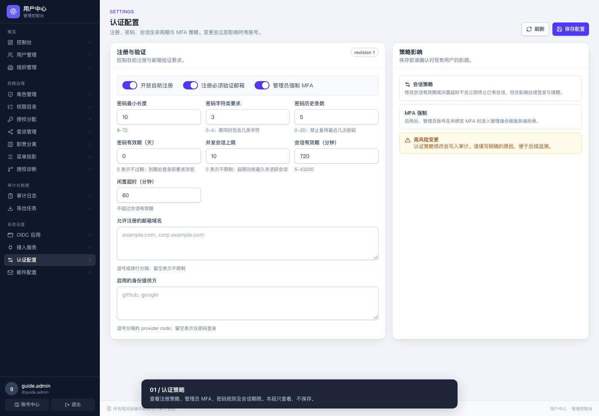

# 管理员操作手册

> 面向平台管理员与组织治理者：用户生命周期、IAM 权限治理、审计导出、系统设置。
> 面向普通账号的操作见 [用户手册](user-guide.md)；部署与密钥管理见 [运维手册](operations.md)。
>
> 按当前页面与服务端实现核对，适用仓库版本 v0.11.0。
> [全部操作视频与录制方法](videos/README.md)。视频使用独立演示库，敏感信息已遮挡；委派、职责分离与认证配置视频仅查看表单，不提交变更。

## 日常操作顺序

| 任务 | 建议路径 | 完成后核对 |
|---|---|---|
| 新员工入职 | 创建用户 → 配置角色权限 → 预览并分配角色 → 加入组织 | 用户完成首次改密；角色及数据范围符合岗位 |
| 调整权限 | 查授权诊断 → 核对角色 grants → 预览 → 提交原因 | 用目标用户检查入口与实际访问；审计可追溯 |
| 账号异常 | 禁用账号或撤销会话 → 核对审计 → 重置凭据或 MFA | 旧会话不再可用，用户按新凭据重新登录 |
| 人员离职 | 撤销组织/平台授权与会话 → 禁用或归档账号 | 先交接组织拥有者；保留审计历史 |
| 接入应用 | 创建 OIDC 应用或接入客户端 → 保存一次性密钥 → 配置接入端 | 回调白名单、最小权限、登录/令牌链路符合预期 |

## 0. 通用规则（先读）

| 规则 | 说明 |
|---|---|
| 菜单按权限投影 | 看不到的入口 = 没有对应权限；前端隐藏不等于授权，服务端二次判定 |
| 写操作必须填原因 | 管理写操作「操作原因」至少 2 个字符，写入审计日志，不可省略 |
| 高风险操作要 Step-up | 按弹窗验证当前密码与 MFA，纯第三方账号按页面重新验证；有效期由配置决定，默认 5 分钟 |
| 并发冲突返回 409 | 详情页编辑携带当前 revision；冲突时刷新数据重试，不覆盖他人修改 |
| 拒绝访问 | 未登录通常为 401，无操作权限为 403；对象越权按接口契约可能表现为 404，不据此判断资源是否存在 |
| 只追加，不物理删除 | 归档保留历史与审计；审计只追加，普通管理员不能删除 |

## 目录

- [1. 进入管理台](#1-进入管理台)
- [2. 控制台概览](#2-控制台概览)
- [3. 用户管理](#3-用户管理)
- [4. 组织管理](#4-组织管理)
- [5. 角色管理](#5-角色管理)
- [6. 权限目录](#6-权限目录)
- [7. 授权分配](#7-授权分配)
- [8. 委派管理](#8-委派管理)
- [9. 职责分离](#9-职责分离)
- [10. 菜单投影](#10-菜单投影)
- [11. 授权诊断](#11-授权诊断)
- [12. 审计日志](#12-审计日志)
- [13. 导出任务](#13-导出任务)
- [14. OIDC 应用](#14-oidc-应用)
- [15. 接入服务](#15-接入服务)
- [16. 认证配置](#16-认证配置)
- [17. 邮件配置](#17-邮件配置)
- [18. 组织与身份提供方设置](#18-组织与身份提供方设置)

## 1. 进入管理台

1. 使用具备管理权限的账号登录。
2. 若管理员账号尚未绑定 MFA，登录后被要求先在安全中心完成 TOTP 绑定。
3. 若为初始密码，先强制改密；完成前无法进入管理台。
4. 点击「管理控制台」进入 `/admin`；没有入口时，先核对账号权限与当前会话激活角色。

## 2. 控制台概览

**入口**：`/admin`

- 统计卡片：用户总数、有效会话、24h 登录、24h 失败登录等，按当前账号的数据范围统计。
- 最近审计事件列表，快速发现异常操作。
- 作为日常巡检起点：失败登录突增、异常授权都应顺藤摸瓜到「审计日志」。

## 3. 用户管理

**入口**：`/admin/users`

**视频：创建用户与核对详情**（禁用、归档和凭据处置见下表）

<video src="./videos/user-create.webm" controls width="720"></video>

[打开或下载创建用户视频](videos/user-create.webm)

### 3.1 查找用户

- 支持关键字（用户名/昵称/邮箱）、状态（已启用/已禁用/已归档）、MFA、角色筛选。
- 列表受数据范围约束：受限管理员只见范围内的账号。

### 3.2 创建用户

1. 「创建用户」→ 填用户名、邮箱、显示昵称。
2. 若通过邮件激活，保持「发送激活邮件」勾选并确认邮箱、SMTP 可用；初始密码可留空。
3. 若直接交付初始密码，取消勾选「发送激活邮件」，填写符合策略的密码；需要凭据治理权限与近期安全验证。
4. 填写操作原因，点击「创建用户」。成功后跳转用户详情；新用户默认授予 `member`，其他角色通过「授权分配」配置。
5. 交付账号后让用户首次登录改密；不要把密码写进工单、审计原因或手册。

### 3.3 用户详情页操作（`/admin/users/:id`）

| 操作 | 说明 |
|---|---|
| 编辑资料 | 显示昵称等；携带当前 revision，并发修改返回 409 |
| 变更邮箱 | 验证码发送到**新邮箱**，用户在新邮箱确认后完成换绑 |
| 重置密码 | 在安全页签发送密码重置邮件；需相应权限与近期验证。实际完成密码重置后旧会话失效 |
| 重置 MFA | 用户遗失第二因素且恢复码不可用时，在核实身份后操作；旧 MFA 与会话失效，用户需重新注册 MFA |
| 撤销会话 | 在会话页签撤销单个或全部会话；提交前核对对象与操作原因 |
| 禁用 / 启用 | 禁用立即阻断登录与会话 |
| 归档 | 保留历史与审计、禁止登录；归档不可登录但不物理删除 |
| 分配角色 | 跳转授权分配；详情页仅展示当前角色 |

**结果检查**：详情页状态与角色分配正确；「审计」能检索到操作者、原因与结果。禁用和归档前先确认目标 ID，避免同名账号误操作。

## 4. 组织管理

**入口**：`/admin/organizations`

- 平台管理员可见全部组织，支持归档；归档保留历史，组织内成员平台账号不受影响。
- 组织内部治理在组织空间 `/orgs/:id` 完成：成员、部门由 owner/admin 按权限管理；自定义组织角色与授权由 owner 或获准的平台管理员管理。个人邮箱等账号安全动作在安全中心操作。
- 职责分离没有平台集中编辑页；应进入对应组织空间操作，只有组织 owner 可以修改规则，其他成员只读。平台身份本身不能代替组织 owner 身份。

## 5. 角色管理

**入口**：`/admin/iam/roles`

- 列表按页面搜索条件筛选；内置角色受保护，不能当作自定义角色任意修改或归档，具体可用操作以详情页为准。
- 「创建角色」：角色代码（创建后不可修改）+ 名称；新角色默认无 grants，进入详情页配置。
- 角色详情 `/admin/iam/roles/:id`：
  - 编辑资料（重命名携带 revision，冲突返回 409）。
  - 配置操作权限（grants）：每个操作一条 grant，含 effect 与数据范围（scope）。
  - 配置继承：继承其他角色的 grants；禁止自环与循环，服务端拒绝成环。
  - 「预览」基于当前编辑中的 grants 与继承展示差异，**不写数据**，提交前先用它核对。

**视频：角色创建与授权分配**

<video src="./videos/iam-grant.webm" controls width="720"></video>

[打开或下载角色与授权视频](videos/iam-grant.webm)

### 最小授权流程

1. 创建自定义角色，填写代码、名称、用途与原因；代码创建后不可修改。
2. 在详情配置实际需要的操作权限、允许/拒绝效果与数据范围，必要时配置继承。
3. 先预览策略变化，再填写原因保存；新角色如果没有 grants 或继承，分配成功也不会新增业务能力。
4. 到「授权分配」给用户分配该角色，再用「授权诊断」确认目标操作与数据范围。

## 6. 权限目录

**入口**：`/admin/iam/permissions`

- 展示系统全部操作权限（operation）与说明；角色 grants 从这里引用。
- 引用某权限的角色/分配可查看；归档权限前确认引用已清理。

## 7. 授权分配

**入口**：`/admin/iam/assignments`

1. 页面下方按用户 ID、角色与状态筛选现有分配；上方「分配配置」用于新增。
2. 在「分配配置」选择角色与数据边界，按需填写生效、过期时间；搜索用户并勾选 →「预览资格」。
   - 预览校验资格、约束冲突与数据范围，失败项显示原因；**不写数据**。
   - 支持批量创建，批量失败会逐项标注。
3. 选择「单个分配」或「批量分配」，填写原因后确认提交。平台授权在此操作，组织授权在对应组织空间操作。
4. 「撤销」使该用户失去对应角色权限；撤销记录保留，不删除行。

> 预览不代表已经授权；以提交结果及分配列表为准。职责分离、委派上限、版本变化都可能阻止最终提交。

## 8. 委派管理

**入口**：`/admin/iam/delegations`

- 用途：把"在限定范围内分配/撤销某个角色"的能力临时交给其他角色，**不授予策略修改权**。
- 点击「新建委派」，在「新建角色委派」表单选择管理角色与目标角色，配置动作（分配/撤销）、目标用户范围、授权上限（grant_ceiling）、有效期、是否允许继续向下委派。
- 所有写操作要求近期安全验证（Step-up）。
- 「撤销」立即使委派失效并推进策略版本。

## 9. 职责分离

**入口**：`/admin/iam/constraints`

- 约束参与角色分配与切换时的校验，防止高风险角色被同一人同时持有。
- 类型：
  - **互斥（mutual_exclusion）**：勾选的角色不能同时授予同一用户。
  - **最大角色数（max_roles）**：只统计勾选的角色，至少为 1；未勾选的内置角色不参与计数。
- 新建/启用/停用规则会写入审计并推进 policy revision。
- 组织域内的职责分离在组织空间「职责分离」页签维护，只在组织内生效，不会放宽平台策略。

**视频：委派与职责分离约束**

<video src="./videos/delegation-sod.webm" controls width="720"></video>

[打开或下载配置表单视频](videos/delegation-sod.webm)

本段视频展示委派和职责分离的配置入口，**没有提交规则，也不代表已完成授权验证**。

## 10. 菜单投影

**入口**：`/admin/iam/menus`

- 菜单项决定 `/me/authorization` 返回的 `menu_keys`，即用户看到的导航。
- `route_key` 与前端路由一一对应，创建后不可修改。
- 每个菜单项配置 `required_all` / `required_any` 权限；**只影响展示，不构成访问控制**（鉴权始终由服务端权限决定）。

## 11. 授权诊断

**入口**：`/admin/iam/explain`

- **解释**：输入目标用户 ID，选择操作权限；可指定资源所有者用户 ID，执行后核对允许/拒绝结果与命中的授权来源。
- **模拟**：填写用户、操作、资源所有者，调整待模拟的角色等条件，查看决策变化；不写任何数据。
- 排障标准动作：用户说"没权限"→ 先在这里解释，再决定是补分配还是改角色。
- 组织内解释在组织空间「角色与授权」页签进行，只加载本租户的角色与授权事实。

## 12. 审计日志

**入口**：`/admin/audits`

**视频：审计查询与导出**

<video src="./videos/audit-export.webm" controls width="720"></video>

[打开或下载审计与导出视频](videos/audit-export.webm)

- 按操作者、动作、目标、时间范围筛选；事件包含 before/after/diff JSON 快照。
- 详情页 `/admin/audits/:id`：完整上下文（操作者、结果、原因、请求 ID、版本信息）；长 JSON 可折叠。
- 组织域事件带租户标识；组织空间「审计」页签只能读本组织事件。
- 审计为只追加存储，不提供删除；`audit.read` 权限控制读取面。

## 13. 导出任务

**入口**：`/admin/exports`

- 来源：「用户管理」「审计日志」中的「导出」按钮，按当前筛选生成 CSV。
- 创建任务时填写原因（写入审计）；导出范围与列表范围一致，受限管理员不能通过导出扩大范围。
- 导出产物 **24 小时内可下载**，过期需重新创建；下载时重新鉴权。
- 授权策略或会话角色版本变化后，原任务可能不能继续下载；先核对当前权限，再按当前范围重新导出。
- CSV 已做公式注入前缀转义，可直接用表格软件打开。
- 单次导出上限 100000 行。

### 实际操作

1. 在「用户管理」或「审计日志」设置筛选，分别点击「搜索」或「筛选」确认结果。
2. 点击「导出」；用户导出需选择字段，只有具备联系方式读取权限时才可选择邮箱。
3. 填写原因 →「创建导出任务」；页面跳转「导出任务」。
4. 确认任务状态后点击下载 CSV；检查内容与筛选一致。下载仍受当前权限和任务有效期限制。

**当前界面限制**：本次实测中，列表已有 1 个可下载任务，但分页总数显示为 0；以实际任务行、状态与下载结果判断是否成功，计数显示问题尚未修复。

## 14. OIDC 应用

**入口**：`/admin/applications`

**视频：创建 OIDC 应用**

<video src="./videos/oidc-app.webm" controls width="720"></video>

[打开或下载 OIDC 应用视频](videos/oidc-app.webm)

1. 点击「创建 OIDC 应用」，填写名称、服务归属、重定向 URI、scope、客户端类型、PKCE 与令牌有效期，填写操作原因。
2. 机密客户端创建后返回 `client_id` 与**一次性 `client_secret`**，立即安全保存；公开客户端不签发密钥，必须使用 PKCE。`client_id` 由服务端生成，不需要填写应用 code。
3. 配置：
   - 重定向 URI：每行一个，**必须精确匹配**（含末尾斜杠与端口）。
   - scope 白名单、Access/Refresh Token TTL（秒）、是否要求 PKCE `code_challenge`、是否公开客户端。
   - 登出回调 URI：RP-initiated logout 返回地址白名单，精确匹配；留空表示不回跳。
4. 「密钥轮换」生成新 secret（同样只展示一次），旧 secret 失效。

**结果检查**：应用列表可见新应用；接入端使用生成的 client_id、正确的回调 URI 与 PKCE 设置验证登录。教程只验证创建成功，不代替第三方应用接入验收。

## 15. 接入服务

**入口**：`/admin/integrations`

- 接入客户端用于服务间 gRPC 鉴权与事件订阅（Webhook）。
- 「创建接入客户端」：code 创建后不可修改；创建后签发**一次性明文凭据**，立即保存，DB 只存摘要。
- 配置：
  - `allowed_methods`：gRPC 方法白名单，最小化授予。
  - `event_subscriptions`：订阅的事件类型（event_type）。
  - `callback_url`：Webhook 地址，**公网回调必须 https**，链路本地/未指定地址会被拒绝。
- 「凭据轮换」签发新凭据；「停用」立即拒绝该客户端。
- 事件投递失败可按原因「重试」；投递为至少一次，消费端按 `event_id` 去重。

## 16. 认证配置

**入口**：`/admin/settings/auth`

**视频：认证配置（密码策略与会话生命周期）**

<video src="./videos/settings-auth.webm" controls width="720"></video>

[打开或下载认证配置视频](videos/settings-auth.webm)

| 项 | 说明 |
|---|---|
| 注册开关 | 控制自助注册；关闭时先由管理员创建账号，组织邀请本身不会创建平台账号 |
| 允许注册的邮箱域名 | 限制注册邮箱域 |
| 密码策略 | 最小长度、字符类数（0-4）、历史条数（0-20）、有效期（0 表示不过期，到期登录强制改密） |
| 会话生命周期 | 空闲超时（分钟）、绝对过期、并发会话上限（0 表示不限制，超限回收最久未活跃会话） |
| MFA 策略 | 管理员是否强制绑定 MFA 等 |

- 点击「保存配置」，填写原因并按需完成安全验证；变更写入审计。密码、会话等设置在各自检查点生效，不能据此认为所有旧会话会被立即清空或重写期限。
- 密码策略只作用于"设置密码"这一刻：存量弱密码不会被追溯（见 security.md 已知限制）。

## 17. 邮件配置

**入口**：`/admin/settings/email`

- 配置注册验证、密码重置与激活邮件的发送通道：SMTP 主机/端口/用户名/密码，支持 465 implicit TLS 与 587 STARTTLS。
- 密钥**只接受写入，不会回显**。
- `console` 驱动仅记录发送元信息、不投递邮件——开发调试用，生产必须配真实 SMTP。
- 保存后新的发送请求走更新后的通道。

### 配置与验收步骤

1. 选择 SMTP 驱动，填写发件人、上游供应商提供的主机、端口与认证信息，核对 TLS 模式。
2. 输入新密钥以更新；保留密钥时按页面提示留空，不要用占位符覆盖。
3. 点击「保存配置」并填写原因；页面只展示是否已配置密钥，不回显原文。
4. 使用专用测试账号申请注册验证码或找回密码，确认邮件到达且验证码可以完成流程。仅保存成功不代表邮件已投递。

## 18. 组织与身份提供方设置

**入口**：`/admin/settings/organization`、`/admin/settings/providers`

- **组织策略**：控制是否限制每用户拥有的组织数量及上限，默认关闭；平台管理员豁免配额。
- **身份提供方**：先由运维按页面列出的环境变量配置上游供应商凭据，并在上游配置回调。页面只展示凭据配置状态、回调地址与启停入口，**不能输入或查看密钥原文**。显示「已配置」后才能启用；使用测试账号核对登录和绑定，避免误把同邮箱账号视为已绑定。

## 附：操作排障速查

| 现象 | 处理 |
|---|---|
| 用户报"没权限" | 授权诊断 → 解释，命中缺失再补分配 |
| 提交返回 409 | 他人已改过同一资源：刷新页面重取 revision 再提交 |
| 弹"需要近期安全验证" | 完成 Step-up，按页面显示的有效期重试，默认 5 分钟 |
| 找不到某用户/组织（404） | 检查自己的数据范围；越权资源统一返回不存在 |
| 审计里查不到读取行为 | 审计只记录写操作与安全事件（已知限制） |
