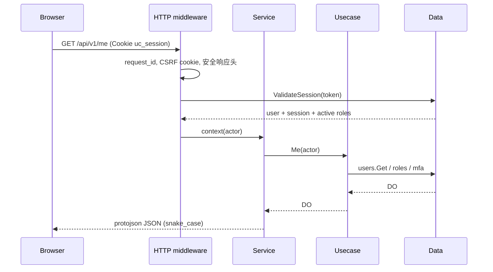

# 架构与分层

## 1. 目标与边界

`user-center` 是单一可部署的 Kratos 服务 + 单一 React SPA。它拥有：

- 账号（`users`）、凭据（`user_credentials`）、外部身份（`user_oauth_identities`）；
- 邮箱验证、密码恢复、MFA 与 Step-up（`auth_flow_completions`、`identity_mfa`、Redis 挑战）；
- 浏览器会话（`iam_sessions`、`iam_session_roles`）；
- 平台 IAM（资源、权限、角色、继承、分配、约束、菜单、审计）；
- 认证配置、导出任务、事务 Outbox。

它**不拥有**：模型 API Key、余额/流水/支付/订阅、路由组、渠道、公告、日志检索。原系统通过用户 ID 关联这些数据，通过 gRPC 读取最小身份事实。

## 2. 组件

| 组件 | 说明 |
|---|---|
| `cmd/user-center` | HTTP `:8080` + gRPC `:9090`；Wire 装配；可选一次性 root 自举 |
| `cmd/migrate` | MySQL 版本化 DDL；SQLite 开发 AutoMigrate；权限目录种子 |
| `cmd/admin-rescue` | 离线 root 创建/凭据恢复，必须拥有数据库与主机权限 |
| MySQL | 权威身份、IAM、审计、Outbox；账号隔离，运行账号无建表权限（生产建议） |
| Redis | 注册/重置/换绑验证码、登录限流、Step-up 证明；不可用时退化为进程内存储（见安全文档） |
| 邮件适配器 | `console`（开发）或 SMTP；不依赖原 `notify-worker` |
| SPA | 用户门户 + 管理控制台，仅消费 `/api/v1` |

## 3. 分层契约

```text
client ──► DTO ──► service ──► DO ──► biz ──► DO ──► data ──► PO ──► MySQL
                                  ▲                ▲
                                  │ 仓储接口        │ 实现
                                  └────────────────┘
```

- `service`：proto ↔ DO；解析 query/pagination；设置/清理 Cookie；不访问存储。
- `biz`：DO、用例、仓储接口、授权决策、审计/Outbox 事务语义；不 import proto 生成的 HTTP 传输。
- `data`：GORM PO、仓储实现、Redis、SMTP；把驱动错误映射为 `biz` 错误。
- `domain/authorization`：纯类型与算法（Scope 求交、决策、继承图），不依赖任何存储/框架。
- `platform/httpx`：server 与 service 共享的已验证传输元数据（request_id、IP、CSRF），避免两层互相 import。
- `cmd` / `internal/wiring`：唯一装配点，Wire 生成 `wire_gen.go`。

## 4. 请求生命周期



写请求额外经过：CSRF 双提交校验 → 会话校验 → 用例内 `Authorize`（操作权限 + 目标范围 + 约束）→ 事务内 CAS + 审计 + Outbox。高风险操作再校验 Step-up。

## 5. 会话与身份版本

- 登录成功后生成 32 字节随机令牌；DB 存 `SHA-256(token)`，不存明文。
- 会话行包含 `identity_version`。每次请求比较用户当前 `identity_version`；不一致立即视为失效并撤销。
- 禁用、归档、密码重置、管理员 MFA 重置都会提升 `identity_version` 并撤销会话。
- 空闲超时由每次请求刷新 `idle_expires_at`；绝对过期由 `expires_at` 控制。
- 会话角色是 `iam_session_roles` 的子集；授权只使用当前会话激活的角色。

## 6. 授权决策

`biz.Services.LoadAuthzFacts` 读取：policy revision、用户 revision、全部角色（含 Grant 与继承边）、用户的有效分配、全部约束。然后：

1. 每个有效分配 → 继承闭包 → 每个有效角色的 Grant 生成 `GrantSource`；
2. 有效 Scope = `Grant.Scope ∩ Assignment.Boundary`；
3. `authorization.Evaluate` 依次检查身份、操作已绑定/启用、约束、allow 覆盖、deny 命中、业务规则；
4. 返回 `Decision{Allowed, Reason, Sources, ValidUntil}`；`Sources` 用于解释与审计。

列表查询把 allow Scope 的粗粒度并集下推到 SQL（`all` / `self` / `id IN (...)`），随后逐行执行 deny 与 self 判定。`total_size` 是粗过滤结果；受限管理员可能看到略大的总数，但不会看到范围外数据。该差异已记录在安全文档。

## 7. 事务与幂等

同一 MySQL 事务内完成：

- 创建用户 + 凭据 + 默认角色分配 + 完成记录 + 审计 + `user.created` Outbox；
- 修改资料 + revision CAS + 审计 + `user.profile.updated`；
- 禁用/归档 + 撤销会话 + 提升身份版本 + 审计 + 状态事件；
- 改密 + 密码版本 + 身份版本 + 撤销其他会话 + 审计 + 事件；
- 角色/权限/分配/约束变更 + policy revision + 审计 + 授权事件。

验证码使用“数据库完成记录唯一键 + Redis 校验后删除”的方式：重复提交被唯一键拒绝，数据库失败可在验证码删除前重试。

## 8. Outbox

业务写在同一事务写 `event_outbox`；`event_deliveries` 保存每个订阅者的投递状态。当前实现持久化事件与投递骨架，Webhook 投递器与订阅管理属于 V1.1。事件载荷不含密码摘要、验证码、TOTP 秘钥、恢复码或第三方令牌。

## 9. 可观测性

- 每个请求生成/透传 `X-Request-ID`，写入安全事件与审计。
- 结构化日志（zap）记录启动、邮件、数据库/迁移错误。
- `/healthz` 供容器探针使用。
- Prometheus / OpenTelemetry 接入点保留在 `cmd` 启动层，当前未默认导出，避免无配置时产生外部依赖。
