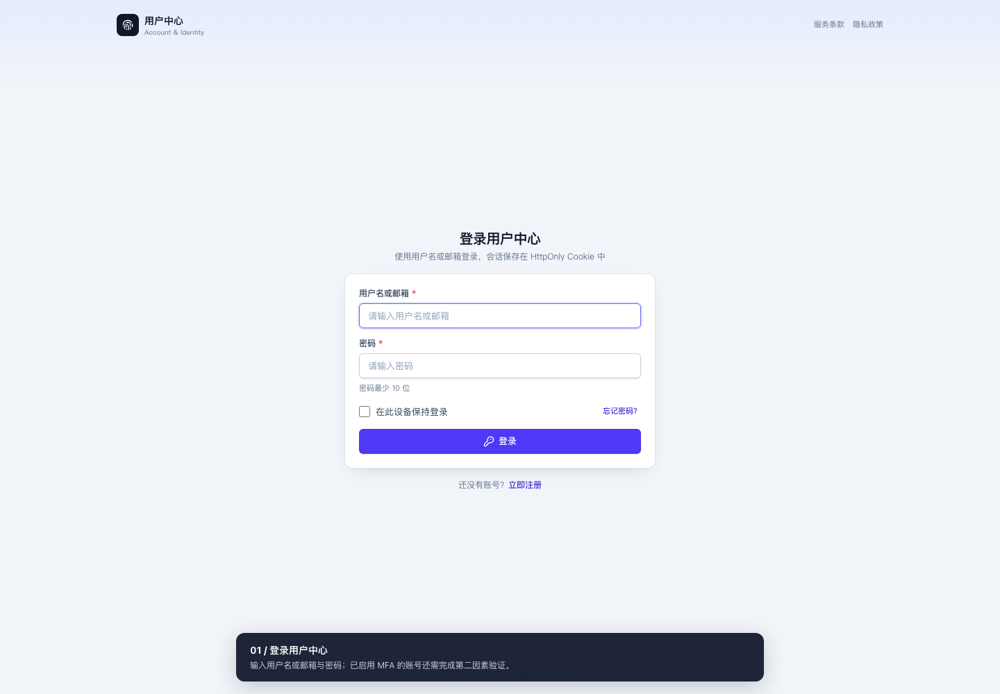
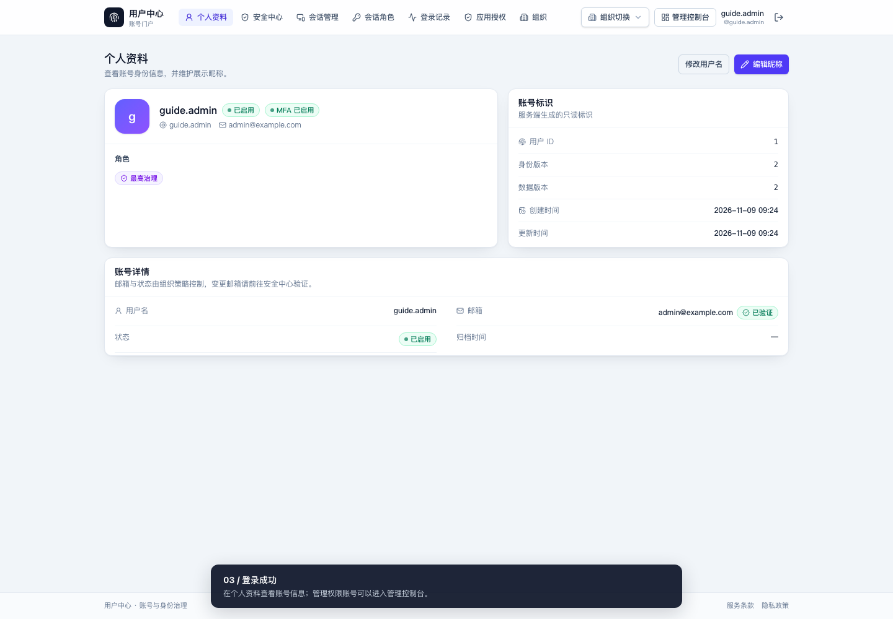
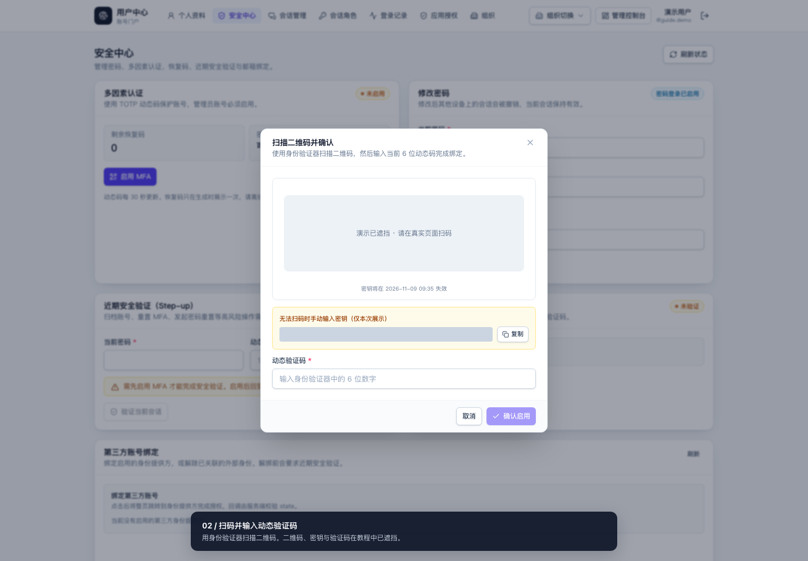
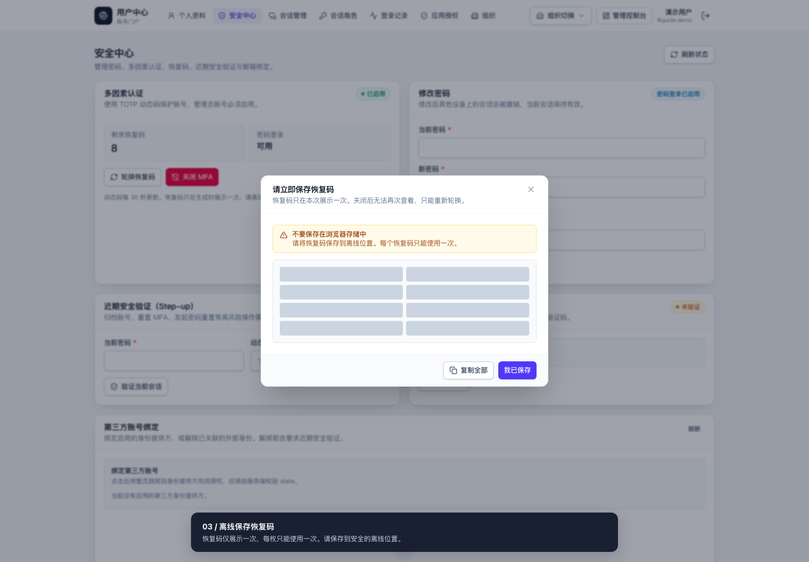
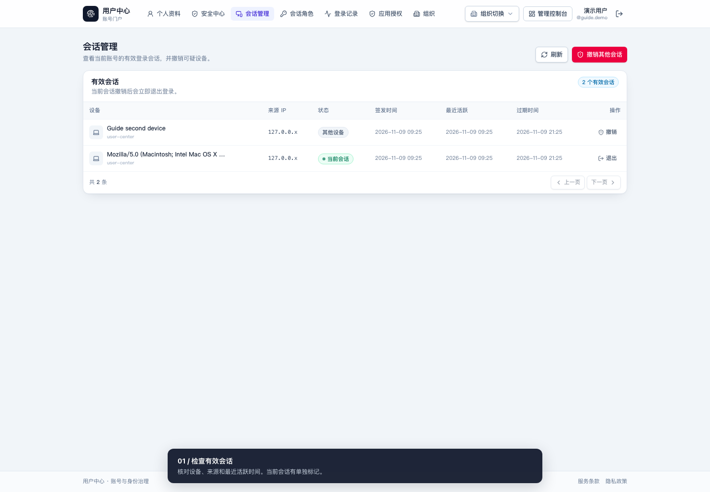
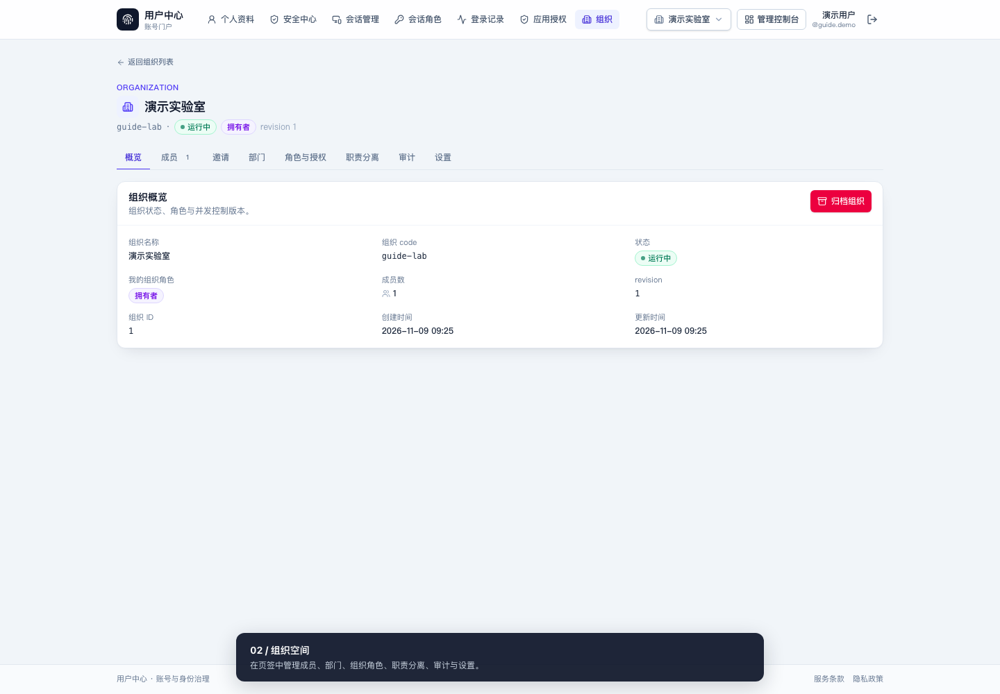
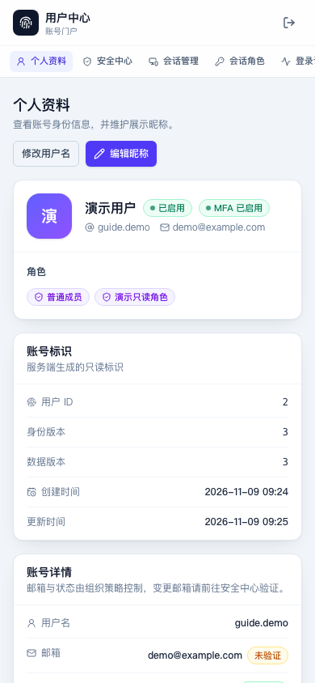

# 用户手册

> 面向所有账号持有者：注册登录、账号安全、会话与应用授权、组织协作。
> 管理台（治理其他账号与策略）的操作见 [管理员操作手册](admin-guide.md)。
>
> 按当前页面与服务端实现核对，适用仓库版本 v0.11.0。视频与截图使用独立演示库，密钥、二维码及恢复码已遮挡。
> [查看全部操作视频](videos/README.md)；Markdown 阅读器不支持视频时，使用章节中的下载链接。

## 第一次使用：按这条路径走

1. 从管理员取得账号，或在开放注册时自行注册。
2. 登录；若提示初始密码或密码到期，先到「安全中心」完成改密。
3. 核对「个人资料」中的用户名和邮箱；在「安全中心」启用 MFA，离线保存恢复码。
4. 在「会话管理」检查设备；在「我的组织」创建组织或接受已有组织的邀请。

移动端顶部导航可左右滑动；没有看见「组织」等入口时，先滑动导航查找。

| 名词 | 对你的含义 |
|---|---|
| MFA / 多因素认证 | 密码之后再验证一次，例如身份验证器动态码、恢复码或已注册的 Passkey |
| 近期安全验证 / Step-up | 高风险操作前重新确认身份；按弹窗输入当前密码与第二因素，纯第三方账号按页面指引重新验证 |
| 平台角色 / 组织角色 | 两套独立权限；拥有某组织的管理权限，不代表可以管理平台全部账号 |
| revision / 版本冲突 | 他人已修改同一条资料。刷新核对后再提交，避免覆盖他人的修改 |

## 目录

- [1. 注册账号](#1-注册账号)
- [2. 登录](#2-登录)
- [3. 找回密码](#3-找回密码)
- [4. 个人资料](#4-个人资料)
- [5. 安全中心](#5-安全中心)
- [6. 会话管理](#6-会话管理)
- [7. 会话角色与登录记录](#7-会话角色与登录记录)
- [8. 应用授权](#8-应用授权)
- [9. 组织](#9-组织)
- [10. 常见问题](#10-常见问题)

## 1. 注册账号

**入口**：登录页「注册」→ `/register`

| 场景 | 说明 |
|---|---|
| 注册开放且要求邮箱验证 | 填写邮箱并发送验证码 → 输入验证码、用户名与密码 → 完成注册 → 返回登录 |
| 注册开放且不要求邮箱验证 | 按页面填写账号资料与密码后提交；是否需要验证码以当前页面为准 |
| 注册关闭 | 页面提示"当前只允许受邀或管理员创建账号"，请等待组织邀请或联系管理员 |
| 邮箱域名限制 | 管理员可配置"允许注册的邮箱域名"，域名外邮箱无法注册 |

- 用户名规则：3-128 位字母、数字、`_` `.` `-`；邮箱即登录标识之一。
- 密码长度与字符类别由页面提示，历史复用由服务器校验；最多 72 字节，首尾不能有空白。
- 出于防账号枚举，邮箱已被注册时不会直接提示"已存在"，而是表现为验证码校验失败。

## 2. 登录

**入口**：`/login`

| 方式 | 步骤 |
|---|---|
| 账号密码 | 输入用户名**或**邮箱 + 密码 |
| 第三方身份 | 点击管理员已启用的身份提供方按钮，按跳转页面完成授权；相同邮箱不会自动合并账号 |
| 已启用 MFA | 密码验证通过后进入第二因素页，输入 6 位 TOTP 动态码或恢复码 |

- 勾选"在此设备保持登录"可延长会话有效期（仍受绝对过期约束）。
- 同一账号并发会话数超限（默认 10）时，最久未活跃的会话被强制回收，登录响应会提示回收数量。
- 连续失败可能触发限流或 MFA 临时锁定，按提示等待后再试。
- 首次登录（管理员创建的初始密码）会强制跳转安全中心改密，完成前不能进入管理台。
- 管理员未绑定 MFA 时，登录后提示先完成 MFA 注册（`MFA_ENROLLMENT_REQUIRED`），绑定前管理功能不可用。

**视频：登录与登录后首页**

<video src="./videos/login.webm" controls width="720"></video>

[打开或下载登录视频](videos/login.webm)

## 3. 找回密码

**入口**：登录页「忘记密码」→ `/forgot-password`

1. 输入用户名或注册邮箱，提交。
2. 收到验证码后打开「设置新密码」页面（`/reset-password`），填写申请时对应的 `challenge_id` 与邮件验证码；如果邮件提供完整链接，可从链接打开。
3. 设置新密码。新密码须通过当前密码策略，且不能与最近 N 次历史密码重复。

> 无论账号是否存在，页面响应都一致，避免被用来探测账号。
> 重置成功后，**该账号全部旧会话失效**，返回登录页使用新密码登录。
> 自助「修改密码」才会保留当前会话。收不到邮件时联系管理员；console 邮件驱动不投递邮件，也不会输出验证码。

**当前操作限制**：自助申请页提交后没有展示 `challenge_id`，自助邮件正文目前只有验证码。如果收到的邮件没有完整重置链接，无法仅凭验证码在界面继续，请联系管理员协助；不要反复申请或尝试猜测 challenge。邮件类流程未纳入本次录屏验收。

## 4. 个人资料

**入口**：登录后的「个人资料」导航（`/account`）。

- 编辑昵称：直接修改保存。
- 修改用户名：需通过当前密码与近期安全验证；用户名与邮箱是登录标识，修改即时生效。
- 页面同时展示当前邮箱、MFA 状态与平台角色；组织角色在组织空间查看。

## 5. 安全中心

**入口**：「安全中心」(`/account/security`) —— 密码、邮箱、MFA、恢复码、Passkey、第三方身份都集中在这里。

**视频：首次登录改密与绑定 MFA**

<video src="./videos/first-login.webm" controls width="720"></video>

[打开或下载首次登录与 MFA 视频](videos/first-login.webm)

### 5.1 修改密码

1. 填写当前密码 + 新密码（两次）。
2. 保存后其他设备会话立即失效。
3. 密码策略（长度、字符类、历史条数、有效期）由管理员配置，违反时按提示调整。

### 5.2 变更邮箱

1. 填写新邮箱 + 当前密码 → 验证码发送到**新邮箱**。
2. 在确认框填入新邮箱收到的验证码完成换绑；确认前账号仍使用原邮箱。
3. 换绑会提升身份版本：其他会话被撤销，需要重新登录。

### 5.3 绑定 TOTP（动态口令）

1. 点击「启用 MFA」，输入当前密码，点击「生成密钥」；页面展示二维码与手动输入密钥。
2. 用 Authenticator（手机 App）扫码添加账户。
3. 输入 App 上当前 6 位验证码，点击「确认启用」。
4. 绑定后：登录需要第二因素；高风险操作（改邮箱、解绑第三方身份等）需要近期验证（Step-up）。

> TOTP 动态码 30 秒一变；连续 5 次输错会锁定 5 分钟。

### 5.4 恢复码

- 绑定 MFA 后生成一组一次性恢复码，**只展示这一次**，请立即离线保存。
- 丢失手机时用恢复码登录（同一码使用一次即作废）。
- 全部用完或怀疑泄露时，可在安全中心重新生成：旧码全部失效。

### 5.5 Passkey / 安全密钥

- 支持 WebAuthn 通行密钥（指纹/面容/安全密钥）绑定，绑定后可用于登录 MFA 与高风险操作的 Step-up。
- 当前作为第二因素使用，不提供单独用 Passkey 替代用户名和密码的无密码登录。

### 5.6 第三方身份绑定

- 已登录状态下可绑定已启用的第三方账号，之后可用对应按钮登录。
- 解绑要求近期安全验证（Step-up）。
- **不能移除最后一种登录方式**：纯 OAuth 账号需先设置本地密码或绑定其他提供方。
- 纯 OAuth 账号设置首个本地密码前，需先"重新验证绑定身份"（跳转提供方确认），5 分钟有效。

## 6. 会话管理

**入口**：「会话管理」(`/account/sessions`)

- 列表展示当前账号所有有效会话：设备/浏览器、IP、最近活跃时间，当前会话有标记。
- 「撤销」可单条结束其他会话；「撤销其他会话」→「全部撤销」清理除本机外的全部会话。被撤销端再次请求时需要重新登录。
- 会话有**空闲超时**与**绝对过期**双重限制，超时后需重新登录，属正常行为。
- 修改密码、换绑邮箱、撤销操作都会使相应会话失效。

**视频：会话管理与登录记录**

<video src="./videos/sessions.webm" controls width="720"></video>

[打开或下载会话管理视频](videos/sessions.webm)

## 7. 会话角色与登录记录

**入口**：「会话角色」(`/account/roles`)、「登录记录」(`/account/activity`)

- **会话角色**：勾选当前需要激活的平台角色并保存；只影响当前会话，不改变管理员给你的长期授权分配。职责分离约束可能阻止某些组合。
- **登录记录**：导航入口为「登录记录」，页面标题为「安全事件」，展示账号相关登录与安全事件。发现陌生记录时，立即修改密码并撤销其他会话。

## 8. 应用授权

**入口**：「应用授权」(`/account/consents`)

- 展示你通过 OIDC 授权过的第三方应用（scope、授权时间）。
- 不再使用的应用应及时「撤销」，撤销后该应用不能再以你的身份换取令牌。
- 应用在请求新的 scope 时会重新弹同意页；`prompt=consent` 也会重新征询。

## 9. 组织

**入口**：「我的组织」(`/orgs`)

**视频：创建组织与查看组织空间**（邮件邀请流程见下文）

<video src="./videos/org-create.webm" controls width="720"></video>

[打开或下载组织操作视频](videos/org-create.webm)

| 组织内角色 | 能力 |
|---|---|
| 拥有者（owner） | 全部管理：成员、部门、角色与授权、设置；可转移拥有者；至少保留一名 |
| 管理员（admin） | 按权限管理普通成员与部门；组织自定义角色、授权和职责分离不因 admin 身份自动获得写权限 |
| 成员（member） | 被授权资源的访问，无管理入口 |

- **创建组织**：「创建组织」→ 填名称与组织 code（2-64 位小写字母/数字/短横线，全局唯一），创建者自动成为拥有者。平台可能配置每用户组织数量配额。
- **接受邀请**：邀请邮件中的链接打开 `/accept-invitation`。
  - 要求已登录，且当前账号邮箱与邀请邮箱**完全一致**（归一化后）；不匹配统一提示无效。
  - 邀请默认 72 小时有效，过期或重复邀请（同邮箱新邀请）会使旧令牌失效。
  - 没有账号不会自动注册，先完成注册再打开链接。
- **组织空间**(`/orgs/:id`)：概览、成员、部门、角色与授权（组织域 IAM）、职责分离、审计、设置。
  - 普通成员以只读为主；成员、部门等由 owner/admin 按权限管理，自定义组织角色与授权由 owner 或获准的平台管理员管理，职责分离只允许 owner 修改。
  - 组织角色独立于平台角色；成员角色（owner/admin/member）是内置组织角色，由成员管理界面维护。
  - 变更成员角色、管理授权等写操作都会要求填写原因并写入组织审计。

### 9.1 添加已有账号、部门与邮件邀请

1. 打开组织空间 →「部门」→ 新建部门，填写 code、名称及上级部门，按页面要求填写原因并提交。
2. 打开「成员」→ 添加成员，输入已存在的用户名或邮箱，选择组织角色、部门并填写原因。
3. 需要邮件邀请时，打开「邀请」，填写收件邮箱、角色与原因后发送；可在列表核对状态或撤销未接受的邀请。
4. 受邀人登录与收件邮箱一致的账号，打开邀请链接并确认；加入后在「我的组织」核对结果。

**结果检查**：成员列表显示目标账号、组织角色与部门；相关变更可在组织「审计」追溯。邀请不替代账号注册，注册关闭时先由管理员创建账号。

### 9.2 离开组织或调整拥有者

- 在成员或设置页面按可见入口操作，提交前确认交接与影响；拥有者须先确保组织仍有其他拥有者。
- 归档会冻结组织内成员与部门等管理操作；不等于删除成员的平台账号。

### 移动端入口示例

## 10. 常见问题

| 问题 | 说明 |
|---|---|
| 登录提示"用户名或密码错误"，但确定没错 | 账号不存在、密码错误或账号被禁用/归档都是这一提示；先用找回密码确认，再联系管理员查状态 |
| 收不到验证码邮件 | 先查垃圾邮件；仍无则联系管理员检查"邮件配置"（SMTP 通道） |
| 换手机后 MFA 用不了 | 用恢复码登录 → 安全中心「关闭 MFA」时使用当前密码与另一枚未使用恢复码 → 重新启用；若管理员策略不允许关闭，或恢复码已丢失，联系管理员重置 MFA |
| 页面突然退出登录 | 会话被撤销（改密/换邮箱/管理员操作/超时）或触发了并发会话回收，重新登录即可 |
| 管理入口看不到 | 菜单与入口由服务端权限投影决定；没有相应角色就不会显示，需要管理员授权 |
| 403 / "无有效权限" | 已登录但无该操作权限；组织内操作还受组织上下文约束，联系 owner/平台管理员 |
| 提示"需要近期安全验证" | 高风险操作要求 Step-up：按弹窗验证身份，默认 5 分钟有效，具体以页面提示为准 |
